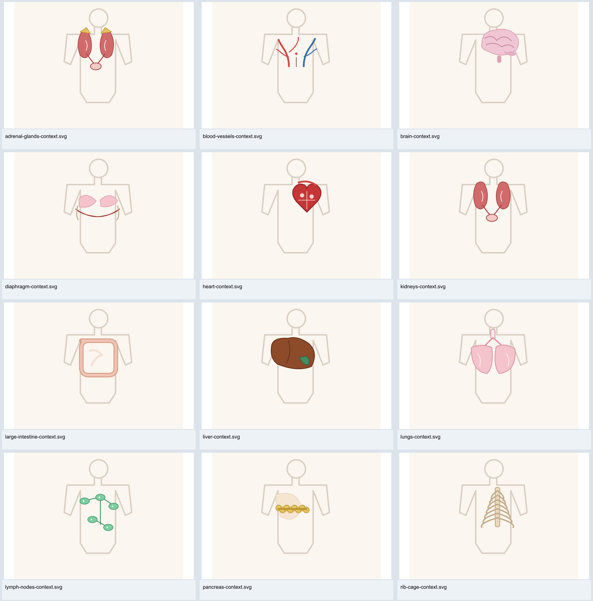
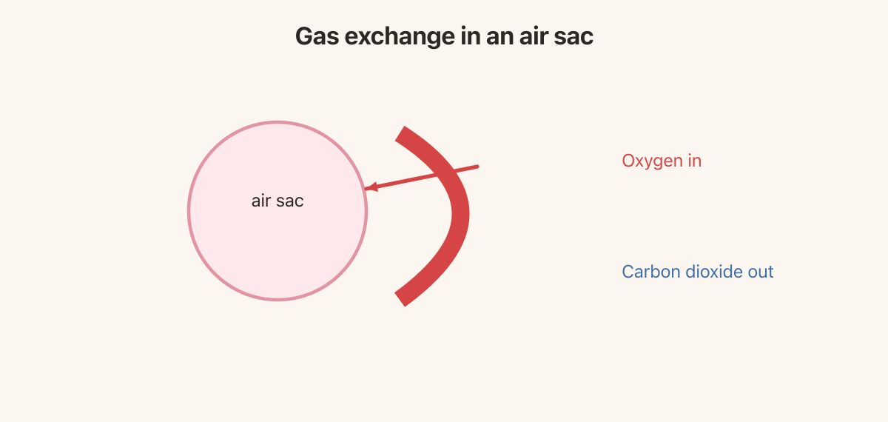

# Body School: independent curriculum and image audit

October 24, 2026 · reviewed commit [`8d533af`](https://github.com/n-sanders/body-school/tree/8d533afcba192bae684e1ea8ca12e0d55de528c6)

## Overall judgment

The seven-unit structure is a workable framework. The recurring connections among movement, circulation, digestion, regulation, and defense are worth keeping. The pancreas’s dual role, spleen-versus-node distinction, and urine-versus-feces distinction are particularly useful choices.

**The present content is not ready for learner release.** The main obstacles are incorrect anatomy in the recognition images, a reversed gas-exchange arrow, an endocrine image outside the agreed scope, and assessments that can be passed through elimination rather than understanding. Most lessons read like summaries awaiting development.

Servier is a good way to improve the anatomy illustrations. It will not by itself fix placement on body maps, ambiguous quiz targets, inadequate explanations, or misleading flow arrows. Keep accurate existing Commons figures where they already do the job.

Companion documents:

- [Lesson-by-lesson audit and revision brief](Lesson-Review.md): all 21 lessons, with measured word counts and concrete improvements.
- [Image audit and Servier replacement queue](Image-Review.md): all 86 existing assets and seven inspected candidates.
- [Inventory and counts](inventory.json), [browser measurements](browser-results.json), and [upstream image credits](UPSTREAM-IMAGE-CREDITS.md).

## Review coverage and limits

Read all 21 lessons and their quizzes, all 21 catalog files, curriculum and original planning notes, image credits, and relevant generation/rendering/validation code. Rendered all 86 local image files successfully and visually screened them on eight contact sheets, inspecting selected problems at full size. Checked all 21 lesson pages at a 1,280-pixel browser width. Cross-checked the principal scientific corrections against linked primary references. This is an editorial/scientific audit, not a claim of independent specialist sign-off for every sentence or every image license.

The source lesson files and artwork have not been rewritten. The local clone is in this chat’s `body-school/` project folder. Audit documents are also copied into that checkout under `docs/audit/independent-2026-10-24/`.

## Findings that should block release

### A1. Rebuild the catalog’s context images; several teach plainly wrong locations

**Evidence:** `public/images/organs/brain-context.svg`, `skull-context.svg`, `kidneys-context.svg`, and others. The brain and skull are drawn across the upper torso rather than inside the head; kidneys/adrenals sit too high; the intestines appear in the chest. Other organs also lack reliable relative size, position, or view markers. The generator places reusable glyphs using ad hoc transforms in [`scripts/make-body-images.py`, lines 392–412](https://github.com/n-sanders/body-school/blob/8d533afcba192bae684e1ea8ca12e0d55de528c6/scripts/make-body-images.py#L392).

**Action:** Retire all 21 context images as a family until rebuilt against one anatomically coherent front/back body map. Some individual locations are closer than others; the recommendation to rebuild the family is a consistency judgment, not a claim that every individual placement is equally wrong. Use subject-right/left markers. Organs seen from behind or in cutaway need explicit view cues.

### A2. Reverse the oxygen arrow and supply a real gas-exchange diagram

In [`circulation-03-gas-exchange.svg`, line 5](https://github.com/n-sanders/body-school/blob/8d533afcba192bae684e1ea8ca12e0d55de528c6/public/images/lessons/circulation-03-gas-exchange.svg#L5), the only exchange arrow runs from the vessel side **toward the air sac**, beside red text saying oxygen enters blood. Carbon dioxide has a label but no corresponding exchange arrow. The caption and prose say the correct thing; the picture contradicts them.

**Action:** Remove the incorrect figure immediately. The already-present `sourced-alveoli.svg` shows the intended directions more clearly and could serve after its layout is fixed. Alternatively adapt a selected SMART gas-exchange figure. Show separate oxygen and carbon-dioxide arrows crossing a labeled air/blood boundary. [NHLBI’s explanation](https://www.nhlbi.nih.gov/health/lungs) supports those directions.

### A3. The endocrine overview violates the selected scope

[`control-02-hormones-and-glands.md`, line 100](https://github.com/n-sanders/body-school/blob/8d533afcba192bae684e1ea8ca12e0d55de528c6/content/lessons/control-02-hormones-and-glands.md#L100) embeds `sourced-endocrine.jpg`, which explicitly labels ovary and testis and depicts reproductive anatomy. The accompanying statement that these glands are outside the course does not remove the content from the lesson.

**Action:** Replace it with a selected-gland map showing pituitary, thyroid, adrenals, and pancreas. Keep accurate urinary anatomy, including urethra, and digestive anatomy, including rectum/anus. Remove repeated scope disclaimers and questions testing what the course omits; they consume teaching and assessment space without advancing anatomy knowledge.

### A4. Recognition targets are ambiguous or mislabeled

[`content/items/thyroid-gland.yaml`, line 2](https://github.com/n-sanders/body-school/blob/8d533afcba192bae684e1ea8ca12e0d55de528c6/content/items/thyroid-gland.yaml#L2) names the item **“Thyroid and pituitary glands”**, although both pinned pictures show a thyroid on a trachea. A learner is rewarded for identifying a combination that is not depicted. Split the concepts; thyroid pictures must answer “thyroid,” while pituitary needs its own location image or text-only treatment.

Adrenal pictures reproduce the kidney picture with caps added, and diaphragm pictures also contain lung-like shapes. With no arrow or consistent emphasis indicating the target, “Which organ is this?” can have several defensible answers. “Find the kidneys” can display kidneys both in the kidney option and in an adrenal distractor. This ambiguity is permitted by the existing distractor relationships and image pool; a specific random quiz run need not exhibit every collision.

**Action:** Highlight exactly one structure, mute context, and use explicit reviewed distractors. Replace the symbolic isolated drawings with recognizable anatomy. Change the catalog’s generic noun to “structure” or “organ or structure”: skull, spine, rib cage, and vessel network are not all single organs.

### A5. Constrain inline images before adding better artwork

The lesson renderer uses ordinary Markdown images. Its CSS styles catalog images but does not set a responsive width for `.prose img`. At a 1,280-pixel viewport, `circulation-03-lungs-and-breathing` has a measured document width of **2,039 pixels**; its alveoli image renders at **1,832 pixels** wide. All four images load. This is a layout failure, not a broken download.

**Action:** Constrain prose images to the available column with proportional height. Keep anatomical figures contained rather than cropped. Then inspect diagrams at actual phone width; mobile layout was not measured in this audit. A responsive shrink alone will not make a densely labeled figure readable—some still need simplification or detail views. See [`src/styles.css`](https://github.com/n-sanders/body-school/blob/8d533afcba192bae684e1ea8ca12e0d55de528c6/src/styles.css#L390) and [`LessonPage.tsx`](https://github.com/n-sanders/body-school/blob/8d533afcba192bae684e1ea8ca12e0d55de528c6/src/pages/LessonPage.tsx#L87).

## Scientific and teaching corrections

### A6. Replace absolutes about muscle with pulling force and examples

[`support-02`, line 92](https://github.com/n-sanders/body-school/blob/8d533afcba192bae684e1ea8ca12e0d55de528c6/content/lessons/support-02-muscles-and-movement.md#L92) says skeletal muscle waits for a decision. That conflicts with automatic breathing, posture, and reflex actions discussed elsewhere. Its account also equates contraction with shortening throughout. Contraction produces tension; muscles can hold a position or control a lowering movement without simply shortening.

**Replacement direction:** “Skeletal muscles produce pulling force. We control many of their actions consciously, and they also take part in automatic actions such as breathing and posture.” Show holding a book as well as lifting it. Students need not memorize contraction subtypes. [OpenStax’s muscle-tension section](https://openstax.org/books/anatomy-and-physiology-2e/pages/10-4-nervous-system-control-of-muscle-tension) distinguishes these actions; [NHLBI](https://www.nhlbi.nih.gov/health/lungs/body-controls-breathing) describes respiratory muscle control.

### A7. Teach hormone targets and qualify the speed comparison

The repeated direct-call/slow-broadcast analogy suggests hormones simply take longer and affect all listeners. Add that only cells with suitable receptors respond, and that some hormonal responses are rapid. Adrenaline is already in the lesson and is an effective counterexample to an absolute “hormones are slow” rule. Explain the hypothalamus’s relationship to the pituitary instead of testing “master gland” as the main fact. [NCI’s endocrine overview](https://training.seer.cancer.gov/anatomy/endocrine/) provides the receptor distinction.

### A8. Correct exercise and breathing explanations

[`together-03`, line 101](https://github.com/n-sanders/body-school/blob/8d533afcba192bae684e1ea8ca12e0d55de528c6/content/lessons/together-03-final-connections.md#L101) frames ordinary exercise regulation as “low oxygen during work.” Teach increased tissue demand and carbon-dioxide removal without implying that normal exercise necessarily means low oxygen in arterial blood. [NHLBI](https://www.nhlbi.nih.gov/health/lungs/body-controls-breathing) describes several inputs to breathing control.

[`together-01`’s quiz, lines 37–42](https://github.com/n-sanders/body-school/blob/8d533afcba192bae684e1ea8ca12e0d55de528c6/content/lessons/together-01-exercise-and-energy.md#L37) asks about deeper breathing but answers with “more often,” confusing depth with frequency. Ask separately about how far the diaphragm moves and how often it contracts. The diaphragm catalog summary should describe quiet exhalation through relaxation and elastic recoil, rather than saying relaxation actively pushes air out.

### A9. Separate tissue fluid from lymph and distinguish immune response types

[`protection-02`, line 79](https://github.com/n-sanders/body-school/blob/8d533afcba192bae684e1ea8ca12e0d55de528c6/content/lessons/protection-02-immune-cells-and-lymph.md#L79) calls the fluid bathing tissues lymph before it enters lymph vessels. Use: “Fluid around cells is tissue fluid; once collected into lymphatic vessels it is called lymph.” The kidney lesson’s “cells are bathed in that blood’s water” should make the intervening tissue fluid clear. Retain the accurate spleen/blood versus node/lymph distinction. [NCI’s lymphatic explanation](https://training.seer.cancer.gov/anatomy/lymphatic/) supports the fluid distinction.

[`protection-03`, line 85](https://github.com/n-sanders/body-school/blob/8d533afcba192bae684e1ea8ca12e0d55de528c6/content/lessons/protection-03-barriers-and-responses.md#L85) combines cellular innate defense, antibodies, and memory under one “second line.” For this age, distinguish barriers and broad early responses from targeted adaptive responses and memory. Barriers are themselves part of immune defense. Antibodies can neutralize targets as well as mark them. [NIGMS’s overview](https://www.nigms.nih.gov/biobeat/2023/12/what-is-the-immune-system) offers a suitable conceptual separation.

## Depth, assessment, and the earlier outline

### A10. Expand explanations and diagram tasks; avoid word-count padding

There are **4,483 words of main prose**, averaging **213.5 per lesson**, with individual lessons at **151–280 words**. Counts exclude frontmatter, headings, image alternative text, and single-line image captions; table text and lists are included. The original 450–700-word target was a design estimate, not a requirement to make every lesson equally long.

| Unit | Current main prose, three lessons | Earlier typical three-lesson target |
|---|---:|---:|
| Organization | 714 | 1,350–2,100 |
| Support | 591 | 1,350–2,100 |
| Circulation | 614 | 1,350–2,100 |
| Fuel | 628 | 1,350–2,100 |
| Control | 615 | 1,350–2,100 |
| Protection | 619 | 1,350–2,100 |
| Together | 702 | 1,350–2,100 |

Catalog cards shown below lessons supply additional words, but do not replace a coherent explanation or guided reading of a diagram. At this depth the earlier 15–25-minute estimate is unsupported unless substantial discussion or activities are added. Do not publish that duration as measured.

Add a concrete mechanism, a worked example, a student trace/prediction, and a transfer check to each substantive lesson. Pilot before fixing durations. Preserve the seven units if that organization works; the difference from my nine-unit draft is not itself a defect.

The most valuable missing elements from the earlier outline are a reliable body-map lesson, distinct breathing-mechanics and gas-exchange treatments, an accessory-digestive-organ explanation, a kidney water-balance example, explicit sensory-organ coverage if eyes/ears remain in the intended scope, and an evidence-based capstone. The [lesson review](Lesson-Review.md) gives a staged 21-to-28-lesson option without requiring a full return to the earlier structure.

### A11. Rebuild the assessment around plausible misconceptions and evidence

The course has **161 questions: 127 text and 34 image**. Across the text questions, the correct answer is tied for longest or is the longest in **97/127** cases under the same word-count rule. That is a screening signal, not a measure of difficulty. More importantly, distractors repeatedly invoke skull sutures, bile, tendons, or organs unrelated to the prompt. Examples include skull sutures needing air during a sprint and alveoli migrating to a cut finger.

Three questions explicitly test the course’s decision to omit reproduction. Replace them with anatomy or systems reasoning. Retain initial confidence-building questions, but later distractors should distinguish believable alternatives. Choice order is shuffled by the app, so authored answer position is not a finding.

The final unit repeats explanations but asks students to produce no evidence-based explanation, interpret no data, and repair no model. Add the earlier plan’s activity/recovery table and a claim supported by two observations, naming three systems and one limit of the evidence. This better serves the intent of [NGSS MS-LS1-3](https://www.nextgenscience.org/pe/ms-ls1-3-molecules-organisms-structures-and-processes); multiple-choice recognition alone is insufficient to establish that performance expectation.

## Review tooling and provenance

### A12. The current audit status is more reassuring than the checks justify

All 42 pinned catalog images are marked `reviewed: true`; all lessons and items name `body-school` as reviewer. The generated report therefore says everything is reviewed despite the visible errors. Treat those fields as existing metadata, not independent approval. Reset or qualify affected records during revision, and record who actually checked anatomy, teaching suitability, and rights.

The validator collects catalog images and lesson frontmatter images, but not images embedded in Markdown bodies. In this repo that means its image-existence loop covers the **42 catalog files**, while the **44 teaching figures** are outside that loop. They currently exist and render, but future missing body images could evade validation. Add Markdown image checks and explicit image-review records. [`scripts/validate-content.ts`, lines 31–35](https://github.com/n-sanders/body-school/blob/8d533afcba192bae684e1ea8ca12e0d55de528c6/scripts/validate-content.ts#L31)

Make credits available in the built site with creator, asset source, and license links. The footer currently refers to a repository Markdown file without exposing a usable credits page. Update blanket OpenStax CC BY claims: the current book page displays CC BY-NC-SA, while the particular [Commons bone-growth asset](https://commons.wikimedia.org/wiki/File:622_Longitudinal_Bone_Growth.jpg) separately documents CC BY 3.0/4.0 grants. Its use is not shown to be invalid merely because the current book has different terms. Preserve asset-specific evidence.

## Verification results

| Check | Result |
|---|---|
| Content schema/integrity, offline | Passed: 21 items, 21 lessons, seven units |
| Content validation with remote source checks | Passed: 46 source URLs; zero remote image URLs |
| Existing automated tests | Passed: 49 tests in four files |
| Production build | Passed; bundle-size warning only |
| Local asset rendering | 86/86 files rendered; zero render errors |
| Browser lesson-page checks | 21/21 pages checked at 1,280px; no broken inline images observed; one page had horizontal document overflow |
| Phone-width browser checks | Not performed; required after responsive-image changes |
| Learner pilot and independent anatomy expert review | Not performed |

The normal `tsx` CLI initially encountered a sandbox IPC restriction. Running the same validator with `node --import tsx` passed; this was an execution-environment issue, not a content failure. Dependencies were installed from an imported lockfile using the bundled runtime. The temporary imported lockfile was removed; application source and the original package lock were not changed.

## Suggested implementation order

1. Correct/remove the reversed gas arrow and out-of-scope endocrine overview; remove the faulty context family from quiz selection until rebuilt.
2. Fix responsive inline-image rendering and catalog target naming/highlighting.
3. Replace the recognition artwork using selected SMART/retained Commons assets and one consistent body-map system.
4. Develop three pilot lessons: body map, breathing/gas exchange, and kidney filtration/water balance. Use the lesson briefs to decide whether more splitting is useful.
5. Revise the remaining text and quizzes, then add the evidence-based capstone.
6. Recheck every lesson/image pairing, attribution, mobile view, and assessment target before marking it independently reviewed.
