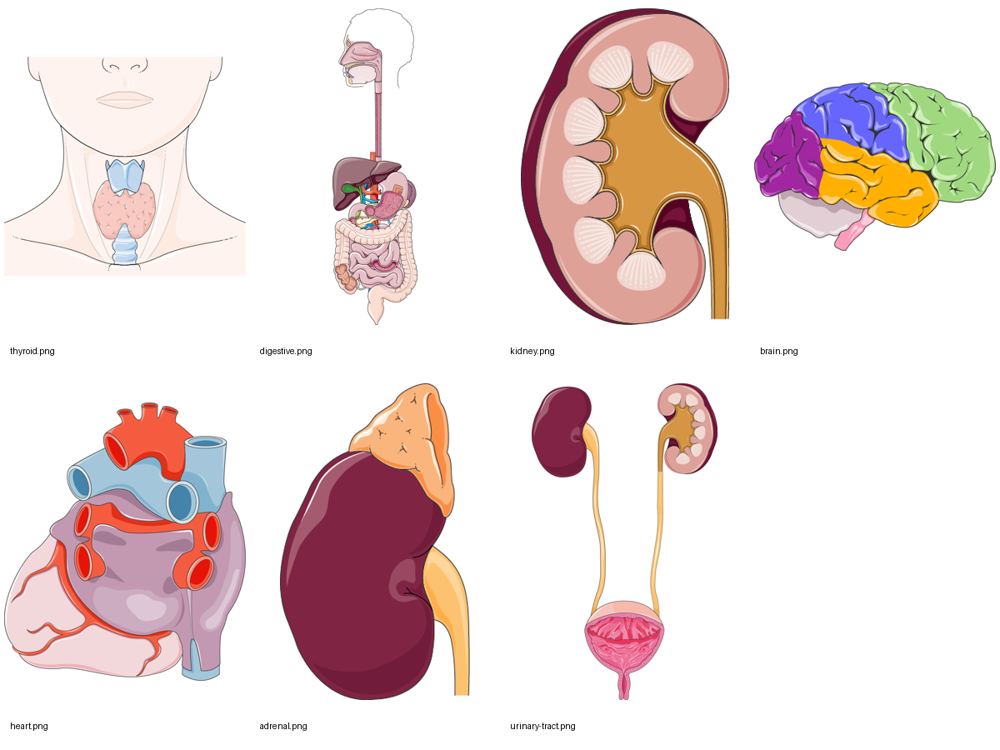

# Image audit and replacement queue

Reviewed all **86 existing files**: 42 catalog drawings, 24 original lesson diagrams, and 20 sourced figures. **76 files are SVGs.** All rendered successfully; successful rendering does not establish correct anatomy. Findings are based on rendered contact sheets, selected full-size inspection, source inspection, and lesson objectives.

The original catalog family needs replacement or rebuilding for teaching/assessment. Some lesson flowcharts can stay. Several existing sourced SVGs are useful and need no new artwork. The priorities below concern meaning, anatomy, readability, and assessment targets rather than the file extension.

## Specific Servier candidates inspected

Seven official PNG downloads were inspected locally. The preview below is a **candidate comparison**, not a new approved course illustration set. None has been inserted into lessons. Source images are unmodified; the sheet resizes and arranges them for audit.

Images provided by [Servier Medical Art](https://smart.servier.com/), licensed under [CC BY 4.0](https://creativecommons.org/licenses/by/4.0/). Arrangement/resizing for this audit; individual source pages are linked below.

| Candidate | Best prospective job | Remaining adaptation |
|---|---|---|

| [Normal thyroid](https://smart.servier.com/smart_image/normal-thyroid/) | Replace thyroid recognition art and help build a selected-gland map | Already includes neck context. Rename the catalog target to thyroid only; do not imply the pituitary is shown. |
| [Complete digestive apparatus](https://smart.servier.com/smart_image/complete-digestive-apparatus-anatamoical/) | Replace crude GI organ relationships and support route tracing | Add a few English labels and food/secretions arrows; use crops for isolated-organ targets. Whole diagram alone does not explain absorption. |
| [Kidney cutaway](https://smart.servier.com/smart_image/kidney/) | Replace the historical nephron as gross-kidney context | This is not itself a nephron-process diagram. Add an English inset and keep blood/urine routes distinct. |
| [Brain](https://smart.servier.com/smart_image/brain-area/) | Replace the brain recognition drawing | Color coding is not a label key. Specify lateral view and add the three selected region labels for teaching; locate inside an accurate skull/body map. |
| [Heart](https://smart.servier.com/smart_image/smart-heart-ov/) | Replace the heart icon with an anatomical external view | Prominent atrial/venous features make view/orientation important; it is not the four-chamber flow diagram. Select/label the appropriate view before use. |
| [Kidney with adrenal gland](https://smart.servier.com/smart_image/adrenal/) | Teach the kidney/adrenal distinction | Point at or emphasize the adrenal. Otherwise the same multi-organ target ambiguity remains. |
| [Urinary tract](https://smart.servier.com/smart_image/urinary-tract/) | Teach kidneys → ureters → bladder → urethra | Uses a bladder cutaway and short urethral depiction; label the selected route and identify it as one schematic view, not all anatomical variants. |

Additional official asset pages were located for [gas exchange](https://smart.servier.com/smart_image/pulmonary-circulation-ov/), [lungs](https://smart.servier.com/smart_image/lungs-11/), [lymph node](https://smart.servier.com/smart_image/lymph-node/), and [elbow](https://smart.servier.com/smart_image/smart-joint-elbow/). These four were not downloaded or visually cleared in this pass. Use them as production leads, not selected final files.

[SMART’s usage FAQ](https://smart.servier.com/using-smart-images-what-you-can-do/) supplies PNG/PPTX formats, permits editing with attribution, and says native SVG downloads are not currently supplied. PNG can replace SVG references where suitable; editable PPTX material may be useful for adaptation. Keep original files, source/creator/license links, view information, changes, and actual reviewer sign-off. Do not assume a category has only normal anatomy or content within this course’s scope.

## Catalog family: 21 entries, two images each

**Action for every row:** replace the isolated symbolic drawing with reviewed anatomical artwork and rebuild its context version against a consistent body map. Some icons might remain as navigation decorations, but they should not be scored anatomical recognition targets. Target highlighting and matched views still need design work after downloading library artwork.

| Existing pair | Specific issue | Replacement starting point |
|---|---|---|

| [`organs/adrenal-glands-diagram.svg`](https://github.com/n-sanders/body-school/blob/8d533afcba192bae684e1ea8ca12e0d55de528c6/public/images/organs/adrenal-glands-diagram.svg) + [`organs/adrenal-glands-context.svg`](https://github.com/n-sanders/body-school/blob/8d533afcba192bae684e1ea8ca12e0d55de528c6/public/images/organs/adrenal-glands-context.svg) | Kidneys dominate; cap target is unmarked, colliding with kidney answers. Context puts the whole tract much too high. | [SMART candidate/search start](https://smart.servier.com/smart_image/adrenal/) |
| [`organs/blood-vessels-diagram.svg`](https://github.com/n-sanders/body-school/blob/8d533afcba192bae684e1ea8ca12e0d55de528c6/public/images/organs/blood-vessels-diagram.svg) + [`organs/blood-vessels-context.svg`](https://github.com/n-sanders/body-school/blob/8d533afcba192bae684e1ea8ca12e0d55de528c6/public/images/organs/blood-vessels-context.svg) | Disconnected red/blue strokes do not show the circulation network or capillary exchange. Context is an arbitrary chest fragment. | [SMART candidate/search start](https://smart.servier.com/) |
| [`organs/brain-diagram.svg`](https://github.com/n-sanders/body-school/blob/8d533afcba192bae684e1ea8ca12e0d55de528c6/public/images/organs/brain-diagram.svg) + [`organs/brain-context.svg`](https://github.com/n-sanders/body-school/blob/8d533afcba192bae684e1ea8ca12e0d55de528c6/public/images/organs/brain-context.svg) | Stylized silhouette is weak for region recognition; context puts the brain in the torso. | [SMART candidate/search start](https://smart.servier.com/smart_image/brain-area/) |
| [`organs/diaphragm-diagram.svg`](https://github.com/n-sanders/body-school/blob/8d533afcba192bae684e1ea8ca12e0d55de528c6/public/images/organs/diaphragm-diagram.svg) + [`organs/diaphragm-context.svg`](https://github.com/n-sanders/body-school/blob/8d533afcba192bae684e1ea8ca12e0d55de528c6/public/images/organs/diaphragm-context.svg) | Lungs and a curved line have no target emphasis; the curve does not clearly teach the relaxed dome or its movement. | [SMART candidate/search start](https://smart.servier.com/smart_image/lungs-11/) |
| [`organs/heart-diagram.svg`](https://github.com/n-sanders/body-school/blob/8d533afcba192bae684e1ea8ca12e0d55de528c6/public/images/organs/heart-diagram.svg) + [`organs/heart-context.svg`](https://github.com/n-sanders/body-school/blob/8d533afcba192bae684e1ea8ca12e0d55de528c6/public/images/organs/heart-context.svg) | Valentine symbol with arbitrary chamber lines is unsuitable as an anatomical recognition target. | [SMART candidate/search start](https://smart.servier.com/smart_image/smart-heart-ov/) |
| [`organs/kidneys-diagram.svg`](https://github.com/n-sanders/body-school/blob/8d533afcba192bae684e1ea8ca12e0d55de528c6/public/images/organs/kidneys-diagram.svg) + [`organs/kidneys-context.svg`](https://github.com/n-sanders/body-school/blob/8d533afcba192bae684e1ea8ca12e0d55de528c6/public/images/organs/kidneys-context.svg) | Use recognizable kidney anatomy and separate urine versus blood connections; context places kidneys in the upper torso. | [SMART candidate/search start](https://smart.servier.com/smart_image/urinary-tract/) |
| [`organs/large-intestine-diagram.svg`](https://github.com/n-sanders/body-school/blob/8d533afcba192bae684e1ea8ca12e0d55de528c6/public/images/organs/large-intestine-diagram.svg) + [`organs/large-intestine-context.svg`](https://github.com/n-sanders/body-school/blob/8d533afcba192bae684e1ea8ca12e0d55de528c6/public/images/organs/large-intestine-context.svg) | A closed rounded rectangle omits the continuous recognizable colon route and terminal connections; context is in the chest. | [SMART candidate/search start](https://smart.servier.com/smart_image/complete-digestive-apparatus-anatamoical/) |
| [`organs/liver-diagram.svg`](https://github.com/n-sanders/body-school/blob/8d533afcba192bae684e1ea8ca12e0d55de528c6/public/images/organs/liver-diagram.svg) + [`organs/liver-context.svg`](https://github.com/n-sanders/body-school/blob/8d533afcba192bae684e1ea8ca12e0d55de528c6/public/images/organs/liver-context.svg) | Generic blob plus gallbladder invites color memorization; a front view must place most liver on subject-right. | [SMART candidate/search start](https://smart.servier.com/smart_image/complete-digestive-apparatus-anatamoical/) |
| [`organs/lungs-diagram.svg`](https://github.com/n-sanders/body-school/blob/8d533afcba192bae684e1ea8ca12e0d55de528c6/public/images/organs/lungs-diagram.svg) + [`organs/lungs-context.svg`](https://github.com/n-sanders/body-school/blob/8d533afcba192bae684e1ea8ca12e0d55de528c6/public/images/organs/lungs-context.svg) | Over-symmetric lungs and simplified airway connections need anatomical grounding; add side/view information. | [SMART candidate/search start](https://smart.servier.com/smart_image/lungs-11/) |
| [`organs/lymph-nodes-diagram.svg`](https://github.com/n-sanders/body-school/blob/8d533afcba192bae684e1ea8ca12e0d55de528c6/public/images/organs/lymph-nodes-diagram.svg) + [`organs/lymph-nodes-context.svg`](https://github.com/n-sanders/body-school/blob/8d533afcba192bae684e1ea8ca12e0d55de528c6/public/images/organs/lymph-nodes-context.svg) | Five identical beans on a line are a symbol, not a body distribution map. Teach representative node locations. | [SMART candidate/search start](https://smart.servier.com/smart_image/lymph-node/) |
| [`organs/pancreas-diagram.svg`](https://github.com/n-sanders/body-school/blob/8d533afcba192bae684e1ea8ca12e0d55de528c6/public/images/organs/pancreas-diagram.svg) + [`organs/pancreas-context.svg`](https://github.com/n-sanders/body-school/blob/8d533afcba192bae684e1ea8ca12e0d55de528c6/public/images/organs/pancreas-context.svg) | Beaded horizontal bar needs a recognizable gland and stomach/duodenum relationship; location image is too high. | [SMART candidate/search start](https://smart.servier.com/smart_image/complete-digestive-apparatus-anatamoical/) |
| [`organs/rib-cage-diagram.svg`](https://github.com/n-sanders/body-school/blob/8d533afcba192bae684e1ea8ca12e0d55de528c6/public/images/organs/rib-cage-diagram.svg) + [`organs/rib-cage-context.svg`](https://github.com/n-sanders/body-school/blob/8d533afcba192bae684e1ea8ca12e0d55de528c6/public/images/organs/rib-cage-context.svg) | Over-reduced ribs/spine do not teach a reliable breastbone/rib enclosure. Use the retained sourced skeleton or selected SMART bones. | [SMART candidate/search start](https://smart.servier.com/) |
| [`organs/skeletal-muscle-diagram.svg`](https://github.com/n-sanders/body-school/blob/8d533afcba192bae684e1ea8ca12e0d55de528c6/public/images/organs/skeletal-muscle-diagram.svg) + [`organs/skeletal-muscle-context.svg`](https://github.com/n-sanders/body-school/blob/8d533afcba192bae684e1ea8ca12e0d55de528c6/public/images/organs/skeletal-muscle-context.svg) | Muscle shapes beside one vertical bone do not establish a real muscle/tendon/joint attachment; context has no defined muscle location. | [SMART candidate/search start](https://smart.servier.com/smart_image/smart-joint-elbow/) |
| [`organs/skin-diagram.svg`](https://github.com/n-sanders/body-school/blob/8d533afcba192bae684e1ea8ca12e0d55de528c6/public/images/organs/skin-diagram.svg) + [`organs/skin-context.svg`](https://github.com/n-sanders/body-school/blob/8d533afcba192bae684e1ea8ca12e0d55de528c6/public/images/organs/skin-context.svg) | Layer symbol needs actual gland/nerve/epidermis structure; context pastes an enlarged skin block over the abdomen with no zoom convention. | [SMART candidate/search start](https://smart.servier.com/) |
| [`organs/skull-diagram.svg`](https://github.com/n-sanders/body-school/blob/8d533afcba192bae684e1ea8ca12e0d55de528c6/public/images/organs/skull-diagram.svg) + [`organs/skull-context.svg`](https://github.com/n-sanders/body-school/blob/8d533afcba192bae684e1ea8ca12e0d55de528c6/public/images/organs/skull-context.svg) | Cartoon face-like bones are too generic; context puts the skull below the head. | [SMART candidate/search start](https://smart.servier.com/) |
| [`organs/small-intestine-diagram.svg`](https://github.com/n-sanders/body-school/blob/8d533afcba192bae684e1ea8ca12e0d55de528c6/public/images/organs/small-intestine-diagram.svg) + [`organs/small-intestine-context.svg`](https://github.com/n-sanders/body-school/blob/8d533afcba192bae684e1ea8ca12e0d55de528c6/public/images/organs/small-intestine-context.svg) | Several disconnected wavy strips depict no continuous intestinal tube; context is in the chest. | [SMART candidate/search start](https://smart.servier.com/smart_image/complete-digestive-apparatus-anatamoical/) |
| [`organs/spinal-cord-diagram.svg`](https://github.com/n-sanders/body-school/blob/8d533afcba192bae684e1ea8ca12e0d55de528c6/public/images/organs/spinal-cord-diagram.svg) + [`organs/spinal-cord-context.svg`](https://github.com/n-sanders/body-school/blob/8d533afcba192bae684e1ea8ca12e0d55de528c6/public/images/organs/spinal-cord-context.svg) | Cord appears beside/in front of simple vertebral blocks without a clear view; context is shortened and lacks correct anatomical relationship. | [SMART candidate/search start](https://smart.servier.com/smart_image/brain-area/) |
| [`organs/spine-diagram.svg`](https://github.com/n-sanders/body-school/blob/8d533afcba192bae684e1ea8ca12e0d55de528c6/public/images/organs/spine-diagram.svg) + [`organs/spine-context.svg`](https://github.com/n-sanders/body-school/blob/8d533afcba192bae684e1ea8ca12e0d55de528c6/public/images/organs/spine-context.svg) | Stack of identical horizontal blocks is a weak vertebral-column target; context lacks appropriate extent/curve/view. | [SMART candidate/search start](https://smart.servier.com/) |
| [`organs/spleen-diagram.svg`](https://github.com/n-sanders/body-school/blob/8d533afcba192bae684e1ea8ca12e0d55de528c6/public/images/organs/spleen-diagram.svg) + [`organs/spleen-context.svg`](https://github.com/n-sanders/body-school/blob/8d533afcba192bae684e1ea8ca12e0d55de528c6/public/images/organs/spleen-context.svg) | Purple blob plus pale stomach is an unmarked multi-organ target; body placement is inconsistent with the upper subject-left abdomen. | [SMART candidate/search start](https://smart.servier.com/smart_image/complete-digestive-apparatus-anatamoical/) |
| [`organs/stomach-diagram.svg`](https://github.com/n-sanders/body-school/blob/8d533afcba192bae684e1ea8ca12e0d55de528c6/public/images/organs/stomach-diagram.svg) + [`organs/stomach-context.svg`](https://github.com/n-sanders/body-school/blob/8d533afcba192bae684e1ea8ca12e0d55de528c6/public/images/organs/stomach-context.svg) | Generic sac lacks convincing entry/exit relationships; location panel places it in the chest. | [SMART candidate/search start](https://smart.servier.com/smart_image/complete-digestive-apparatus-anatamoical/) |
| [`organs/thyroid-gland-diagram.svg`](https://github.com/n-sanders/body-school/blob/8d533afcba192bae684e1ea8ca12e0d55de528c6/public/images/organs/thyroid-gland-diagram.svg) + [`organs/thyroid-gland-context.svg`](https://github.com/n-sanders/body-school/blob/8d533afcba192bae684e1ea8ca12e0d55de528c6/public/images/organs/thyroid-gland-context.svg) | Graphic shows thyroid only while item name promises thyroid and pituitary; context also places thyroid too low. | [SMART candidate/search start](https://smart.servier.com/smart_image/normal-thyroid/) |

Use an arrow, an outline, or contrast to identify the structure being tested. Do not display two answer options that both visibly contain the target, such as kidneys and kidney-with-adrenal. Front/back/lateral views and section views should be identified without giving away the answer.

## Original teaching figures: all 24

| File | Recommendation | Reason / needed teaching work | Library lead |
|---|---|---|---|

| [`lessons/circulation-01-heart-path.svg`](https://github.com/n-sanders/body-school/blob/8d533afcba192bae684e1ea8ca12e0d55de528c6/public/images/lessons/circulation-01-heart-path.svg) | Replace/merge | Keep the ordered route, but remove the symbolic heart; teach chamber/valve connections on real anatomy. | [SMART candidate/search start](https://smart.servier.com/smart_image/smart-heart-ov/) |
| [`lessons/circulation-02-three-vessels.svg`](https://github.com/n-sanders/body-school/blob/8d533afcba192bae684e1ea8ca12e0d55de528c6/public/images/lessons/circulation-02-three-vessels.svg) | Redraw | Three disconnected strokes cannot show branching, continuity, or exchange; add tissue-fluid arrows. | [SMART candidate/search start](https://smart.servier.com/) |
| [`lessons/circulation-03-air-path.svg`](https://github.com/n-sanders/body-school/blob/8d533afcba192bae684e1ea8ca12e0d55de528c6/public/images/lessons/circulation-03-air-path.svg) | Keep with revision | Useful route scaffold. Distinguish a whole lung from airway segments; add actual airway anatomy. | [SMART candidate/search start](https://smart.servier.com/smart_image/lungs-11/) |
| [`lessons/circulation-03-gas-exchange.svg`](https://github.com/n-sanders/body-school/blob/8d533afcba192bae684e1ea8ca12e0d55de528c6/public/images/lessons/circulation-03-gas-exchange.svg) | Replace urgently | Only arrow points toward air sac beside oxygen label; no matching carbon-dioxide arrow. | [SMART candidate/search start](https://smart.servier.com/smart_image/pulmonary-circulation-ov/) |
| [`lessons/control-01-nerve-signal.svg`](https://github.com/n-sanders/body-school/blob/8d533afcba192bae684e1ea8ca12e0d55de528c6/public/images/lessons/control-01-nerve-signal.svg) | Redraw/adapt | Show two actual cells, direction along a neuron, and transmitter crossing a clear gap; do not substitute for a reflex map. | [SMART candidate/search start](https://smart.servier.com/smart_image/brain-area/) |
| [`lessons/control-02-hormone-message.svg`](https://github.com/n-sanders/body-school/blob/8d533afcba192bae684e1ea8ca12e0d55de528c6/public/images/lessons/control-02-hormone-message.svg) | Redraw | Show gland-to-blood transport and responding versus nonresponding cells with receptors; qualify slower. | [SMART candidate/search start](https://smart.servier.com/smart_image/normal-thyroid/) |
| [`lessons/control-03-feedback-loop.svg`](https://github.com/n-sanders/body-school/blob/8d533afcba192bae684e1ea8ca12e0d55de528c6/public/images/lessons/control-03-feedback-loop.svg) | Redraw | A linear sequence stops after change reverses; explicitly close the feedback loop on the monitored variable. | [SMART candidate/search start](https://smart.servier.com/) |
| [`lessons/fuel-01-sandwich-path.svg`](https://github.com/n-sanders/body-school/blob/8d533afcba192bae684e1ea8ca12e0d55de528c6/public/images/lessons/fuel-01-sandwich-path.svg) | Keep or convert to table | An acceptable sequence reminder, but mostly duplicates the text and is not a body-route diagram. | [SMART candidate/search start](https://smart.servier.com/smart_image/complete-digestive-apparatus-anatamoical/) |
| [`lessons/fuel-02-absorption.svg`](https://github.com/n-sanders/body-school/blob/8d533afcba192bae684e1ea8ca12e0d55de528c6/public/images/lessons/fuel-02-absorption.svg) | Replace | No pancreas, villus, intestinal lining, or crossing into transport fluid; cannot explain the lesson objective. | [SMART candidate/search start](https://smart.servier.com/smart_image/complete-digestive-apparatus-anatamoical/) |
| [`lessons/fuel-03-kidney-filter.svg`](https://github.com/n-sanders/body-school/blob/8d533afcba192bae684e1ea8ca12e0d55de528c6/public/images/lessons/fuel-03-kidney-filter.svg) | Replace | Keep/release lists do not show filtration, reclamation, blood route, or final urine route. | [SMART candidate/search start](https://smart.servier.com/smart_image/kidney/) |
| [`lessons/organization-01-levels.svg`](https://github.com/n-sanders/body-school/blob/8d533afcba192bae684e1ea8ca12e0d55de528c6/public/images/lessons/organization-01-levels.svg) | Replace | Colored circles getting larger show size rather than meaningful nested biological organization. | [SMART candidate/search start](https://smart.servier.com/smart_image/complete-digestive-apparatus-anatamoical/) |
| [`lessons/organization-01-tissues.svg`](https://github.com/n-sanders/body-school/blob/8d533afcba192bae684e1ea8ca12e0d55de528c6/public/images/lessons/organization-01-tissues.svg) | Replace | Dots/curves/triangles are not useful examples of all four tissue structures; use an organ-wall model or selected tissue illustrations. | [SMART candidate/search start](https://smart.servier.com/) |
| [`lessons/organization-02-organ-from-tissues.svg`](https://github.com/n-sanders/body-school/blob/8d533afcba192bae684e1ea8ca12e0d55de528c6/public/images/lessons/organization-02-organ-from-tissues.svg) | Replace | Outer organ blob and two arrows do not locate lining, wall muscle, nerves, and connective tissue. | [SMART candidate/search start](https://smart.servier.com/smart_image/complete-digestive-apparatus-anatamoical/) |
| [`lessons/organization-03-systems-link.svg`](https://github.com/n-sanders/body-school/blob/8d533afcba192bae684e1ea8ca12e0d55de528c6/public/images/lessons/organization-03-systems-link.svg) | Redraw | Muscles → Blood → Lungs → Food has unlabeled arrows and is easily read as the wrong physical route. | [SMART candidate/search start](https://smart.servier.com/) |
| [`lessons/protection-01-skin-jobs.svg`](https://github.com/n-sanders/body-school/blob/8d533afcba192bae684e1ea8ca12e0d55de528c6/public/images/lessons/protection-01-skin-jobs.svg) | Convert to text/table | Five text boxes add no anatomy beyond the nearby bullet list; spend the image slot on a skin cross-section. | [SMART candidate/search start](https://smart.servier.com/) |
| [`lessons/protection-02-immune-team.svg`](https://github.com/n-sanders/body-school/blob/8d533afcba192bae684e1ea8ca12e0d55de528c6/public/images/lessons/protection-02-immune-team.svg) | Convert or replace | Four colored circles are a legend without structures, jobs, or relationships; distinguish proteins, cells, and organs. | [SMART candidate/search start](https://smart.servier.com/smart_image/lymph-node/) |
| [`lessons/protection-03-two-defenses.svg`](https://github.com/n-sanders/body-school/blob/8d533afcba192bae684e1ea8ca12e0d55de528c6/public/images/lessons/protection-03-two-defenses.svg) | Replace framework | Separate barrier/broad innate response from adaptive targeting/memory; avoid one undifferentiated second line. | [SMART candidate/search start](https://smart.servier.com/) |
| [`lessons/support-01-joint-types.svg`](https://github.com/n-sanders/body-school/blob/8d533afcba192bae684e1ea8ca12e0d55de528c6/public/images/lessons/support-01-joint-types.svg) | Redraw/adapt | Mechanical symbols may be a labeled analogy, but need real joint relationships and a stated model limit. | [SMART candidate/search start](https://smart.servier.com/smart_image/smart-joint-elbow/) |
| [`lessons/support-01-skeleton-jobs.svg`](https://github.com/n-sanders/body-school/blob/8d533afcba192bae684e1ea8ca12e0d55de528c6/public/images/lessons/support-01-skeleton-jobs.svg) | Convert to text/table | Duplicates the skeleton-jobs list; use real skeleton/bone detail for the main visual. | [SMART candidate/search start](https://smart.servier.com/) |
| [`lessons/support-02-muscle-types.svg`](https://github.com/n-sanders/body-school/blob/8d533afcba192bae684e1ea8ca12e0d55de528c6/public/images/lessons/support-02-muscle-types.svg) | Replace | Same red curve appears three times while captions claim stripes, branching, and sheets. | [SMART candidate/search start](https://smart.servier.com/) |
| [`lessons/support-03-muscle-pairs.svg`](https://github.com/n-sanders/body-school/blob/8d533afcba192bae684e1ea8ca12e0d55de528c6/public/images/lessons/support-03-muscle-pairs.svg) | Replace | No complete joint or two-bone anatomy; muscles do not visibly attach across an elbow or show two positions. | [SMART candidate/search start](https://smart.servier.com/smart_image/smart-joint-elbow/) |
| [`lessons/together-01-exercise-chain.svg`](https://github.com/n-sanders/body-school/blob/8d533afcba192bae684e1ea8ca12e0d55de528c6/public/images/lessons/together-01-exercise-chain.svg) | Keep as table | A useful recap. Add actual observations/data and a reasoning task rather than another list alone. | [SMART candidate/search start](https://smart.servier.com/) |
| [`lessons/together-02-meal-chain.svg`](https://github.com/n-sanders/body-school/blob/8d533afcba192bae684e1ea8ca12e0d55de528c6/public/images/lessons/together-02-meal-chain.svg) | Redraw | Strict sequence through insulin then kidneys implies a misleading universal fate for meal nutrients; branch the routes. | [SMART candidate/search start](https://smart.servier.com/smart_image/complete-digestive-apparatus-anatamoical/) |
| [`lessons/together-03-connections.svg`](https://github.com/n-sanders/body-school/blob/8d533afcba192bae684e1ea8ca12e0d55de528c6/public/images/lessons/together-03-connections.svg) | Redraw | Four variables pointing to one circle do not show a feedback mechanism; use a worked loop or annotated scenario. | [SMART candidate/search start](https://smart.servier.com/) |

## Existing sourced figures: all 20

These recommendations address teaching fit and visible content. Retention still requires preserving the applicable per-file attribution. [The upstream credits](UPSTREAM-IMAGE-CREDITS.md) are included unchanged as a provenance reference; blanket licensing assertions in that file are not all endorsed by this audit.

| File | Recommendation | Reason / conditions | Alternative if needed |
|---|---|---|---|

| [`lessons/sourced-adrenal.jpg`](https://github.com/n-sanders/body-school/blob/8d533afcba192bae684e1ea8ca12e0d55de528c6/public/images/lessons/sourced-adrenal.jpg) | Keep | Clear kidney/adrenal contrast; highlight the adrenal target if used in a quiz. | [SMART candidate/search start](https://smart.servier.com/smart_image/adrenal/) |
| [`lessons/sourced-alveoli.svg`](https://github.com/n-sanders/body-school/blob/8d533afcba192bae684e1ea8ca12e0d55de528c6/public/images/lessons/sourced-alveoli.svg) | Keep; fix display | Already shows opposite gas directions and can replace the erroneous original immediately. Intrinsic width overflows the page. | [SMART candidate/search start](https://smart.servier.com/smart_image/pulmonary-circulation-ov/) |
| [`lessons/sourced-bone-growth.jpg`](https://github.com/n-sanders/body-school/blob/8d533afcba192bae684e1ea8ca12e0d55de528c6/public/images/lessons/sourced-bone-growth.jpg) | Move to optional detail | Many growth-plate/histology labels are untaught; disproportionate main-lesson complexity. Commons separately records CC BY grants. | [SMART candidate/search start](https://smart.servier.com/) |
| [`lessons/sourced-brain.svg`](https://github.com/n-sanders/body-school/blob/8d533afcba192bae684e1ea8ca12e0d55de528c6/public/images/lessons/sourced-brain.svg) | Supplement or replace main | External head/brain view does not label the three regions learners must distinguish; supplement with an appropriate region map. | [SMART candidate/search start](https://smart.servier.com/smart_image/brain-area/) |
| [`lessons/sourced-digestive.svg`](https://github.com/n-sanders/body-school/blob/8d533afcba192bae684e1ea8ca12e0d55de528c6/public/images/lessons/sourced-digestive.svg) | Keep with guided labels | Useful anatomical context; select the few labels/routes needed per lesson and avoid label overload. | [SMART candidate/search start](https://smart.servier.com/smart_image/complete-digestive-apparatus-anatamoical/) |
| [`lessons/sourced-endocrine.jpg`](https://github.com/n-sanders/body-school/blob/8d533afcba192bae684e1ea8ca12e0d55de528c6/public/images/lessons/sourced-endocrine.jpg) | Replace urgently | Explicit ovary/testis labels and reproductive anatomy are outside the agreed course scope. | [SMART candidate/search start](https://smart.servier.com/smart_image/normal-thyroid/) |
| [`lessons/sourced-heart-flow.svg`](https://github.com/n-sanders/body-school/blob/8d533afcba192bae684e1ea8ca12e0d55de528c6/public/images/lessons/sourced-heart-flow.svg) | Keep | Substantive flow/chamber diagram already available; add a guided route and readable label set. A SMART replacement is optional. | [SMART candidate/search start](https://smart.servier.com/smart_image/smart-heart-ov/) |
| [`lessons/sourced-intestines.svg`](https://github.com/n-sanders/body-school/blob/8d533afcba192bae684e1ea8ca12e0d55de528c6/public/images/lessons/sourced-intestines.svg) | Keep or simplify | Useful small-versus-large intestine context; explain route/absorption rather than only framing/coils. | [SMART candidate/search start](https://smart.servier.com/smart_image/complete-digestive-apparatus-anatamoical/) |
| [`lessons/sourced-lymph-node.svg`](https://github.com/n-sanders/body-school/blob/8d533afcba192bae684e1ea8ca12e0d55de528c6/public/images/lessons/sourced-lymph-node.svg) | Keep with guide | Clear lymph entry/exit and cell-rich node. Do not make all B/T-cell labels required knowledge. | [SMART candidate/search start](https://smart.servier.com/smart_image/lymph-node/) |
| [`lessons/sourced-lymphatic.jpg`](https://github.com/n-sanders/body-school/blob/8d533afcba192bae684e1ea8ca12e0d55de528c6/public/images/lessons/sourced-lymphatic.jpg) | Simplify for main use | A real body map; thin linework and extra surface detail make a cleaner, selected-node silhouette preferable. Keep as optional reference. | [SMART candidate/search start](https://smart.servier.com/smart_image/lymph-node/) |
| [`lessons/sourced-muscle-structure.jpg`](https://github.com/n-sanders/body-school/blob/8d533afcba192bae684e1ea8ca12e0d55de528c6/public/images/lessons/sourced-muscle-structure.jpg) | Keep as optional detail | Useful fibers/bundles/tendon, but extra fascia labels exceed lesson objectives. It does not replace a moving elbow picture. | [SMART candidate/search start](https://smart.servier.com/smart_image/smart-joint-elbow/) |
| [`lessons/sourced-muscle-tissues.jpg`](https://github.com/n-sanders/body-school/blob/8d533afcba192bae684e1ea8ca12e0d55de528c6/public/images/lessons/sourced-muscle-tissues.jpg) | Keep with explanation | Actual micrographs can support the three-type comparison; identify what students should notice and do not call them schematic drawings. | [SMART candidate/search start](https://smart.servier.com/) |
| [`lessons/sourced-nephron.png`](https://github.com/n-sanders/body-school/blob/8d533afcba192bae684e1ea8ca12e0d55de528c6/public/images/lessons/sourced-nephron.png) | Replace main figure | Dense historical/Latin labels are poorly matched to grades 6–8 and to filtration/reabsorption objectives. | [SMART candidate/search start](https://smart.servier.com/smart_image/kidney/) |
| [`lessons/sourced-neuron.svg`](https://github.com/n-sanders/body-school/blob/8d533afcba192bae684e1ea8ca12e0d55de528c6/public/images/lessons/sourced-neuron.svg) | Keep with selected labels | Useful actual neuron layout; focus on cell body/long signal path/terminal without testing every specialized label. | [SMART candidate/search start](https://smart.servier.com/smart_image/brain-area/) |
| [`lessons/sourced-pituitary.jpg`](https://github.com/n-sanders/body-school/blob/8d533afcba192bae684e1ea8ca12e0d55de528c6/public/images/lessons/sourced-pituitary.jpg) | Keep | Useful pituitary location within a brain section; show the selected target and optionally deemphasize untaught pineal/brainstem labels. | [SMART candidate/search start](https://smart.servier.com/smart_image/brain-area/) |
| [`lessons/sourced-respiratory.svg`](https://github.com/n-sanders/body-school/blob/8d533afcba192bae684e1ea8ca12e0d55de528c6/public/images/lessons/sourced-respiratory.svg) | Keep with simplification | Accurate full anatomy but dense labels; use crop/zoom or selected labels for airway and diaphragm lessons. | [SMART candidate/search start](https://smart.servier.com/smart_image/lungs-11/) |
| [`lessons/sourced-skeleton.svg`](https://github.com/n-sanders/body-school/blob/8d533afcba192bae684e1ea8ca12e0d55de528c6/public/images/lessons/sourced-skeleton.svg) | Keep | A much better anatomical context than the original catalog symbols; guide skull/rib/spine identification. | [SMART candidate/search start](https://smart.servier.com/) |
| [`lessons/sourced-skin-layers.svg`](https://github.com/n-sanders/body-school/blob/8d533afcba192bae684e1ea8ca12e0d55de528c6/public/images/lessons/sourced-skin-layers.svg) | Optional detail plus simple main | Thick/thin skin, receptors, and plexus labels exceed the core objective; create a simplified selected-layer teaching version. | [SMART candidate/search start](https://smart.servier.com/) |
| [`lessons/sourced-thyroid.jpg`](https://github.com/n-sanders/body-school/blob/8d533afcba192bae684e1ea8ca12e0d55de528c6/public/images/lessons/sourced-thyroid.jpg) | Keep or replace for consistency | Usable thyroid/parathyroid contrast; do not conflate it with pituitary. A selected normal-thyroid view is cleaner for the target. | [SMART candidate/search start](https://smart.servier.com/smart_image/normal-thyroid/) |
| [`lessons/sourced-urinary.jpg`](https://github.com/n-sanders/body-school/blob/8d533afcba192bae684e1ea8ca12e0d55de528c6/public/images/lessons/sourced-urinary.jpg) | Keep | Good simple urinary route within scope; may already do the lesson job without a wholesale replacement. | [SMART candidate/search start](https://smart.servier.com/smart_image/urinary-tract/) |

## Contact sheets used for screening

The sheets preserve filenames so the recommendations can be checked against rendered files. Source figures are reproduced for review; creator/license/source information accompanies them in [UPSTREAM-IMAGE-CREDITS.md](UPSTREAM-IMAGE-CREDITS.md). Add actual license links to the final learner-facing credits page. Some source files include extra anatomy or labels unsuitable for core lessons; inclusion here documents the audit, not approval.

- [Catalog isolated, sheet 1](evidence/catalog-isolated-1.png)
- [Catalog isolated, sheet 2](evidence/catalog-isolated-2.png)
- [Catalog context, sheet 1](evidence/catalog-context-1.png)
- [Catalog context, sheet 2](evidence/catalog-context-2.png)
- [Original teaching, sheet 1](evidence/lesson-original-1.png)
- [Original teaching, sheet 2](evidence/lesson-original-2.png)
- [Sourced teaching, sheet 1](evidence/lesson-sourced-1.png)
- [Sourced teaching, sheet 2](evidence/lesson-sourced-2.png)

## Practical first replacement batch

1. Use the existing correct alveoli source instead of the reversed-arrow original, after constraining image size.
2. Replace the reproductive-inclusive endocrine overview with a selected-gland map. The inspected thyroid, adrenal, pancreas material, and retained pituitary source can contribute.
3. Replace brain/skull/kidney context images and build the shared body map; then rebuild the rest of the context family rather than adjusting arbitrary transforms individually.
4. Replace the heart symbol and fix target identity for thyroid/pituitary, adrenal/kidney, and diaphragm/lung questions.
5. Develop process-specific original/adapted diagrams for the elbow, gas exchange, villus absorption, nephron reclamation, and closed feedback loop. These need a teaching brief even with library components.

The workload is not 86 bespoke medical illustrations. Retain good sourced figures, remove redundant text-box images, reuse selected organ artwork, and reserve original drawing effort for relationships and processes that the course needs to explain.
